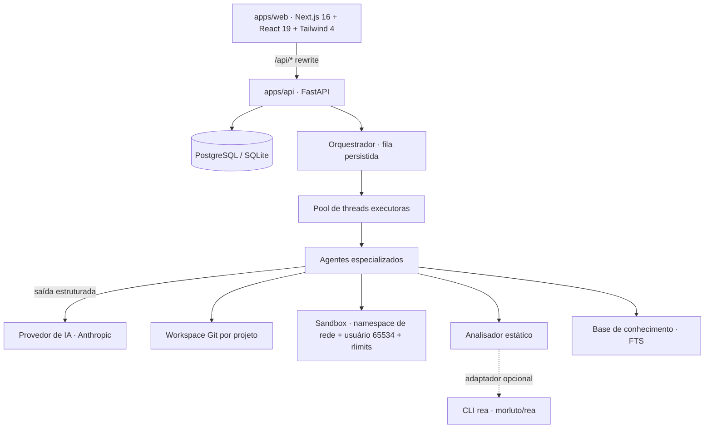

# Arquitetura do GENISIA AI (MVP)

## Visão geral



| Camada | Local | Responsabilidade |
|---|---|---|
| Interface | `apps/web` | Telas do produto; nenhuma regra de negócio |
| API | `apps/api/genisia/routers` | Validação (Pydantic), autenticação, autorização por projeto, paginação, OpenAPI |
| Orquestração | `genisia/orchestrator` | Fluxos como DAG de etapas, despacho por dependências, tentativas, cancelamento, retomada, aprovações |
| Agentes | `genisia/agents` | Lógica de cada especialidade; recebem só o contexto das dependências |
| Execução | `genisia/execution` | Workspace Git do projeto e sandbox de testes |
| Análise | `genisia/analysis` | Importação segura, análise estática, adaptador REA |
| Conhecimento | `genisia/knowledge` | Extração de catálogos, busca textual, memória de projeto |
| IA | `genisia/ai` | Abstração de provedores, preços, validação de respostas |
| Persistência | `genisia/models.py`, `migrations/` | SQLAlchemy 2 + Alembic |

## Modelo de dados

`User`, `Project`, `Task` (fluxo raiz ou etapa), `AgentRun` (cada execução de agente, com tokens/custo/logs),
`Artifact` (planos, relatórios, logs de teste, entregas), `Repository`, `KnowledgeSource`, `KnowledgeItem`,
`Integration` (configuração não secreta + segredo cifrado), `AuditEvent`, `Approval`.
Identificadores são UUID hex; todas as entidades têm datas de criação/atualização e chaves estrangeiras com
`ON DELETE` explícito.

## Máquina de estados das etapas

```
queued ──(dependências ok)──▶ running ──▶ succeeded
   ▲                             │  ├──▶ failed      (definitiva ou tentativas esgotadas)
   │  (nova tentativa)           │  ├──▶ skipped     (etapa não aplicável / dependência falhou)
   └─────────────────────────────┘  ├──▶ cancelled
                                    └──▶ awaiting_approval ──(aprovada)──▶ queued
                                                          └─(rejeitada)──▶ failed
```

- Etapas `optional` podem falhar sem bloquear as seguintes; etapas `run_always` (relatório final) executam
  mesmo se dependências falharem, para que a entrega relate os problemas.
- O estado vive no banco: ao reiniciar, etapas `running` voltam para `queued` (`recover()`), e as execuções
  interrompidas ficam registradas como `interrupted`.
- Cancelamento é cooperativo: etapas na fila são canceladas na hora; etapas em execução verificam o pedido
  (o sandbox mata o grupo de processos). Chamadas de IA em andamento não são interrompidas no meio.

## Fluxos (workflows)

| Fluxo | Etapas |
|---|---|
| `mission` | research → architect (IA) → plan_approval (humano) → develop (IA) → qa (sandbox + correção) → security / optimize (opcionais) → deliver |
| `plan` | research → architect → plan_approval |
| `develop` | develop → qa → security / optimize → deliver (exige plano aprovado) |
| `test` | qa sem correção automática |
| `analyze_repository` | import → reverse (+REA) → security / optimize → ai_review (opcional, IA) → report |
| `ingest_knowledge` | import → reverse → ingest (catálogo → base de conhecimento) |

## Segurança

- **Autenticação** JWT (HS256) com senhas bcrypt; **autorização** por proprietário em todos os recursos
  (respostas 404 para recursos de terceiros).
- **Segredos**: chaves de API cifradas com Fernet (chave derivada de `GENISIA_SECRET_KEY`), nunca devolvidas;
  logs passam por `redact()`; a varredura de segredos guarda só impressões digitais.
- **Execução isolada**: código gerado nunca roda no processo do backend. O sandbox copia o workspace para um
  diretório descartável e executa um comando da lista permitida (`pytest`, `node --test`, `npm test` sem
  dependências) em namespace de rede vazio, como usuário 65534, com limites de CPU, memória, tamanho de
  arquivo, descritores e tempo, ambiente limpo e saída truncada. O diretório de dados é `711`/`700` e o banco
  `600`, então o código em sandbox não lê banco, chave nem segredos (coberto por teste).
- **Sistema de arquivos**: caminhos enviados por agentes/usuários são normalizados (sem `..`, absolutos,
  `.git`, `.github`, barras invertidas); ZIPs são extraídos com proteção contra *zip-slip* e bombas.
- **Rede/SSRF**: importação Git só via HTTPS, hosts permitidos, sem credenciais na URL, IPs internos
  bloqueados, clone raso sem submódulos e sem hooks; diretórios locais só dentro de `GENISIA_IMPORT_ROOTS`.
- **Aprovação humana** para: executar o plano (gerar e rodar código), excluir projeto/repositório,
  liberar rede no sandbox.
- **Limites**: limitador de requisições por cliente; no máximo 3 fluxos ativos por projeto; orçamento de IA por
  projeto verificado antes de cada chamada.

## Limitações conhecidas

- O limitador de requisições é em memória (uma instância). Para várias instâncias, usar Redis.
- O despachante usa threads no processo da API; para cargas maiores, mover os executores para processos
  dedicados (a fila já é o banco, então a troca não muda o modelo de dados).
- Quando o backend não roda como root, o sandbox usa namespace de usuário (`unshare -r`), que isola a rede
  mas não troca o usuário efetivo — nesse caso prefira o backend Docker.
- O backend Docker do sandbox é validado no CI (runners sem namespaces de usuário); o backend `namespace` é validado localmente como root.
